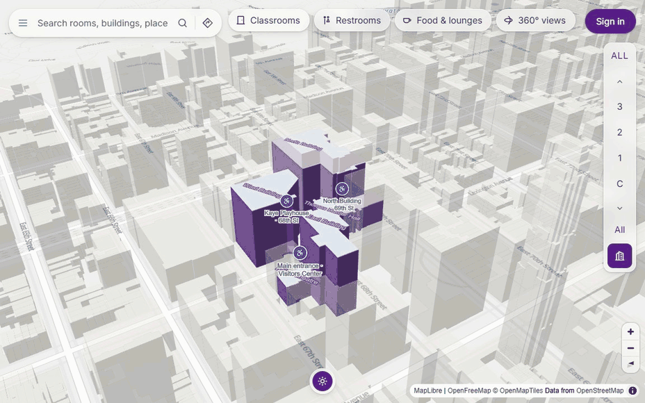
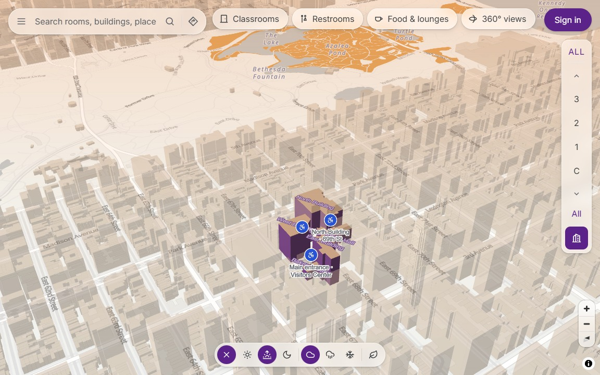
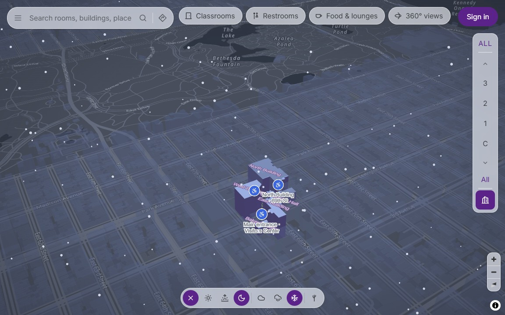
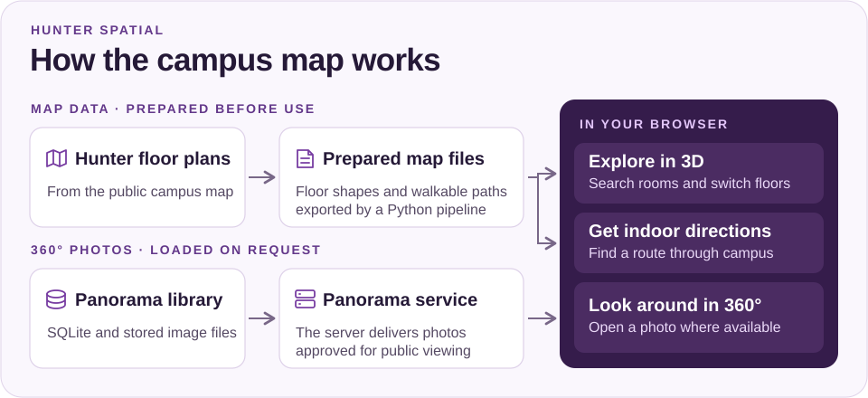

<p align="center">
  
</p>

<h1 align="center">Hunter Spatial</h1>

<p align="center">
  <strong>A 3D campus map and indoor directions for CUNY Hunter College.</strong><br />
  Search for rooms, switch floors, and find your way around the 68th Street campus.
</p>

<p align="center">
  <a href="https://hunter-spatial-web.vercel.app"><strong>Open the map</strong></a> ·
  <a href=".github/readme/campus-demo.mp4?raw=true">Demo video (MP4)</a>
</p>

<p align="center">
  <picture>
    <source media="(prefers-reduced-motion: reduce)" srcset=".github/readme/campus-map.png" />
    
  </picture>
</p>

## Try it

- **Find a room in 3D.** Search for `TH114` to jump to its floor in Thomas Hunter Hall.
- **Get indoor directions.** Try `W117` to `TH114` and select **Step-free** to follow a route via elevators and skybridges.
- **Explore the campus.** Open the scene controls at the bottom of the outdoor map to change the time of day, weather, and season.
- **Take the first-week tour.** Find it in the map menu to visit spots like the OneCard Office and Cooperman Library.

### Campus scenes

| Autumn at golden hour | A snowy winter night |
| :---: | :---: |
|  |  |

## Quick start

Requires Node.js 22.13 or newer.

```bash
npm install
npm run dev
```

Open [localhost:3000](http://localhost:3000). Run tests with `npm test`.
For optional setup, see [360° photos](database/README.md) and [rebuilding map data](data/SOURCE.md).

## How it works



[Tech stack](stack.md) · [Routing flowchart](stack.md#route-request-flow) · [Project plan](plan.md)
