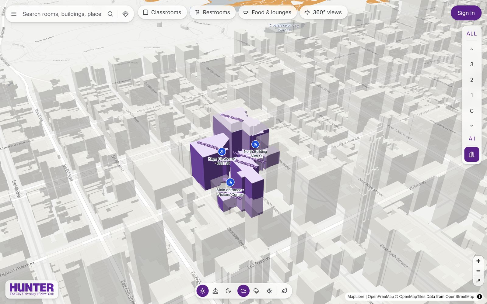
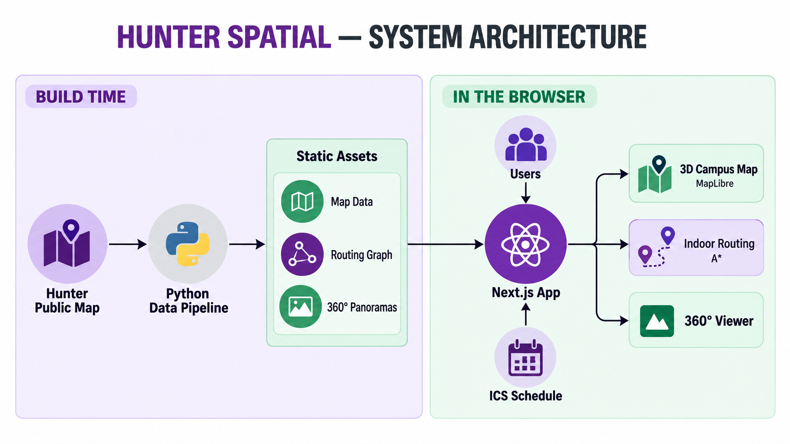

<p align="center">
  
</p>

<h1 align="center">Hunter Spatial</h1>

<p align="center">
  <strong>A 3D indoor campus map and wayfinding engine for CUNY Hunter College.</strong><br />
  Search a room, switch floors, and follow a route through the buildings, not just the streets.
</p>

<p align="center">
  <a href="https://hunter-spatial-web.vercel.app">Live site</a> ·
  <a href="stack.md">Tech stack</a> ·
  <a href="plan.md">Project plan</a>
</p>

<p align="center">
  
  
  
  
  
  
</p>

<p align="center"><em>Capstone project at CUNY Hunter College (68th Street campus).</em></p>

<p align="center">
  
</p>

## Overview

- **Search any room** by code (`N304`, `HN 304`) and jump to it on the right floor.
- **3D floor plans:** every building and floor is extruded in the browser, with a floor switcher and filters for classrooms, restrooms, and food.
- **Indoor routing:** A* over Hunter's walkable graph, across floors, skybridges, and elevators, with an accessible-only mode.
- **360° views** of key spots, submitted by students with a `@login.cuny.edu` account and published only after review.
- **Time of day and weather** on the map, from day to night, rain, and snow.

## How it works



1. A one-time Python pipeline extracts Hunter's public floor plans into GeoJSON and a routing graph ([data/SOURCE.md](data/SOURCE.md)). The live app never calls the original map service.
2. MapLibre GL renders the floors as 3D extrusions from static files.
3. `ngraph.path` finds the shortest route in the browser, from hallway node to the room's door.
4. Panoramas load on demand from Next.js routes backed by SQLite and local image storage.

## Run it

Requires Node.js 22.13+ (and Python 3 to rebuild the map data).

```bash
npm install
npm run db:init && npm run db:seed   # optional: panorama database and example image
npm run dev                          # http://localhost:3000, try searching N304
npm test
```

To rebuild the map data from a local HAR capture (never committed):

```bash
python scripts/extract_har.py
python scripts/convert_to_geojson.py
```

See [database/README.md](database/README.md) for the panorama schema, endpoints, and the reviewer demo account.

---

<sub>Indoor geometry is a one-time academic extract from Hunter College's public campus map and is not covered as open source. Not an official Hunter College product.</sub>
