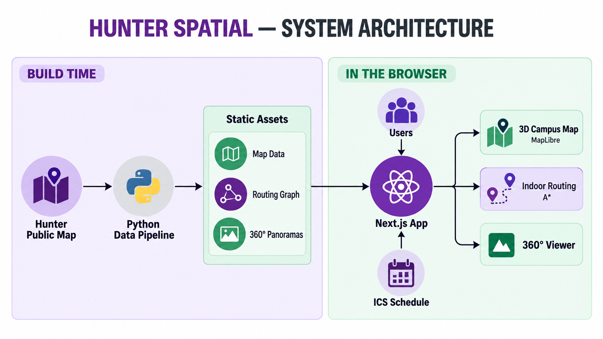

# Hunter Spatial

Indoor wayfinding for CUNY Hunter College (68th Street). Students pick a building and floor, search a room code, and see the extruded floor plan in MapLibre.

See [plan.md](plan.md) for architecture and milestones. Geometry comes from a one-time HAR extract ([data/SOURCE.md](data/SOURCE.md)).

## System Architecture: The Two-Layer Paradigm



Hunter Spatial decouples indoor navigation into two complementary display layers:
* **Layer 1 (3D Campus Map):** Hardware-accelerated 3D vector floor plans and route ribbons rendered in **MapLibre GL JS**.
* **Layer 2 (360° Viewer):** On-demand photorealistic 360° interior panoramas rendered in **Pannellum** at key campus landmarks.

Geometry and navigation graphs are prepared offline and served as static assets.
Panoramas are loaded at runtime through the Next.js backend, with metadata in
SQLite and image files in local storage. The user-upload workflow is being added
in phases; the modal and persistent read endpoints are implemented first.

## Tech Stack

| Category | Core Technology | Role in Hunter Spatial |
|:---|:---|:---|
| **Web & UI** | Next.js 15, React 19, TypeScript 5, Tailwind CSS v4 | Application shell, reactive floor state, search autocomplete, responsive drawers |
| **3D Geospatial** | MapLibre GL JS v6 (WebGL2), OpenFreeMap | GPU-accelerated 3D campus masses, extruded indoor room plans, and route ribbons |
| **Routing Engine** | `ngraph.graph`, `ngraph.path` (A* Algorithm) | Sub-3ms in-browser 3D shortest pathfinding, multi-floor routing, and ADA filter |
| **Data Pipeline** | Python 3, GeoJSON (WGS84) | Offline HAR extraction, geometry cleanup, 3D room boundaries, and graph generation |
| **Testing Suite** | Vitest, Python `unittest` | Unit and integration testing across frontend logic and geospatial pipelines |

> 📖 **Full Architectural Reference:** See [**stack.md**](stack.md) for in-depth descriptions of each tool, algorithm details, data formats, and design decisions (such as MapLibre GL JS vs. Three.js).

## Run

```bash
cd apps/web
npm install
npm run dev
```

Open [http://localhost:3000](http://localhost:3000). Search `N304` or pick a building and floor.

For the panorama development example, use Node.js 22.13+ and run these from the
project root before starting the app:

```bash
npm run db:init
npm run db:seed
```

Search and select `N304`, then click **View in 360°** to open the example in a
closable modal. This is test imagery, not a verified N304 photo. See
[database/README.md](database/README.md) for the schema, endpoints, and backup
instructions. The **Upload** tab now supports sign-up, sign-in/out, location
selection, panorama preview, pending uploads, and My submissions. Review screens
are Phase 4; uploaded images are not published automatically.

Accounts use `@login.cuny.edu`. See [Reviewer demo account](database/README.md#reviewer-demo-account)
for the precreated reviewer's email, initial password, and setup command.

```bash
python scripts/extract_har.py          # HAR -> data/raw/ (gitignored)
python scripts/convert_to_geojson.py   # -> apps/web/public/data/hunter-floors.geojson
npm test                               # from apps/web
```

## Folders

- [plan.md](plan.md) — stages, milestones, and data rules
- [Panorama upload system plan](docs/panorama-upload-plan.md) — detailed design and five implementation phases for user-submitted panoramas
- [stack.md](stack.md) — full technical stack, algorithms, data formats, and testing reference
- `apps/web` — the Next.js web application
- `scripts/` — data extraction, geometry conversion, and routing graph scripts
- `database/` — panorama SQLite schema, storage documentation, and development fixture
- `data/` — local HAR only (gitignored); do not commit `.har` or `data/raw/`
